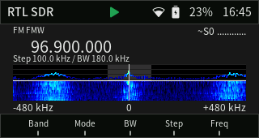
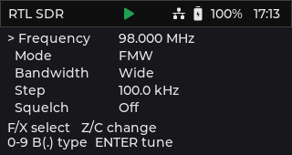

# RTL SDR

A pocket radio receiver for the **Cardputer Zero**, using an **RTL-SDR USB dongle**. It is receive-only and never transmits.

Tune from 0.1 MHz to about 1.7 GHz: broadcast FM, AM and shortwave, airband, military airband, marine, and the 2 m, 70 cm and 23 cm ham bands. You get a live spectrum and waterfall, a relative S meter, squelch, an auto notch and RIT.

Plug the dongle into the USB-A port and connect an antenna. The package installs a udev rule so no root is needed.

Small tuning changes use digital tuning within the current capture window. In FMW, the
waterfall's unavailable outer edge is blank until the hardware tuner recenters.

## Keys

| Key | What it does |
| --- | --- |
| `Z` / `C` (or ←/→) | Tune down / up |
| `4` `5` `6` `7` | Band / mode / filter bandwidth / tuning step. Step and bandwidth auto-set to suit the band and mode |
| `8` | Frequency page: `F`/`X` pick Frequency, Mode (USB/LSB/AM/CW/FMN/FMW), Bandwidth, Step or Squelch; `Z`/`C` change it; type digits (`B` or `,` = decimal point) and `Enter` to tune; `Esc` back |
| `Q` | Cycle squelch (Off, 1–9) |
| `N` | Auto notch on/off |
| `R` | RIT on/off. While on, `F` / `X` shift it up / down |
| `U` / `I` | Dark / light theme |
| `Fn+A` / `Fn+S` / `Fn+D` | Mute / volume down / volume up |
| `H` | Help popup |
| `Esc` | Back, or quit |

 

## Building

The device build requires target ALSA headers and library. If the BSP lacks the headers, extract
the matching ARM64 `libasound2-dev` package and configure with
`cmake --preset cp0-cross -DALSA_INCLUDE_DIR=<extracted-dir>/usr/include` before the workflow.
The device build fails rather than producing a receiver without audio support.

```sh
cmake --preset darwin-arm64 && cmake --build build/darwin-arm64   # desktop simulator
cmake --workflow --preset cp0-cross-package                        # arm64 .deb in dist/
```

## Licence

MIT
